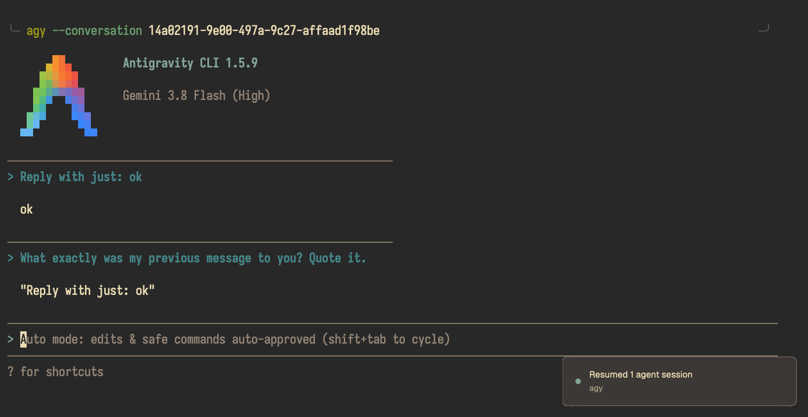

# Agent Revive for Herdr

A [Herdr](https://herdr.dev) mod that brings your coding agents back after a
reboot. Herdr restores each pane as a plain shell in its old folder; Agent
Revive types the resume command into each one, so every tab is back on the
conversation it had.



| Agent       | Resumed with                    |
|-------------|---------------------------------|
| Claude Code | `claude --resume <id>`          |
| Codex       | `codex --no-daemon resume <id>` |
| OpenCode    | `opencode -s <id>`              |
| agy         | `agy --conversation <id>`       |

Works with any shell (zsh, bash, fish, ...). macOS and Linux.

## Install

1. Copy the mod into your Herdr home:

   ```sh
   cp -R mods/agent-revive ~/.config/herdr-app/mods/
   ```

2. Wire up the agents' hooks (only the agents you have installed are touched;
   each file is backed up once as `<file>.before-agent-revive`):

   ```sh
   sh ~/.config/herdr-app/mods/agent-revive/setup.sh
   ```

3. Add the mod to your layout as an invisible floating block on the root node.
   Herdr's shipped layouts are read-only, so clone one first:

   ```sh
   herdr-app do layout.clone '{"name":"main","as":"my-layout"}'
   ```

   then add to the root of `~/.config/herdr-app/layouts/my-layout.json`:

   ```json
   "floating": [ { "id": "agent-revive", "content": { "mod": "agent-revive" }, "edge": "bottom", "align": "start" } ]
   ```

4. Restart your agents so their hooks run. Codex asks you to review the new
   hooks on its next start: trust them.

Check it: `herdr-app check ~/.config/herdr-app/mods/agent-revive`.

## What it touches

- Runs `hc send` to type the resume command into a restored terminal.
- Reads `~/.claude/sessions/*.json` (to pick up a Claude already running).
- `setup.sh` edits `~/.claude/settings.json`, `~/.codex/hooks.json`,
  `~/.gemini/config/hooks.json` and adds
  `~/.config/opencode/plugins/agent-revive/tui.js`. `sh setup.sh --remove`
  takes it all out.
- No network access.

## Limits

- Claude Code sessions in background mode aren't revived: one daemon hosts
  them for several terminals, so the terminal can't be told.
- A conversation you closed yourself isn't revived; only ones whose terminal
  was restored by herdr-core.

See [`mods/agent-revive/README.md`](mods/agent-revive/README.md) for how it
works and [`RECIPE.md`](RECIPE.md) to build it from scratch.

## License

MIT
