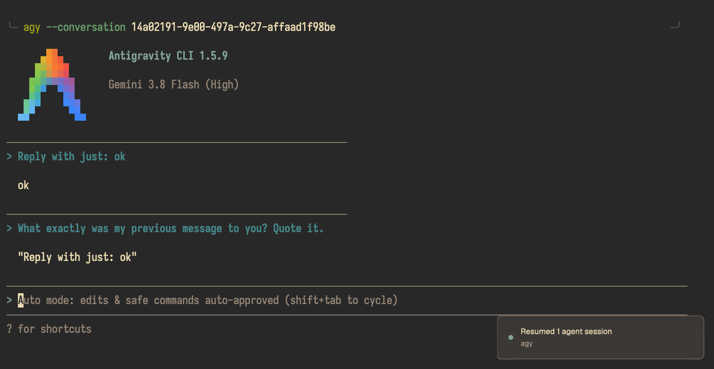

# Agent Revive

After a reboot (or whenever herdr-core loses a terminal), Herdr brings every
pane back as a plain shell in its old folder, but the coding agents that were
running there are gone. Agent Revive puts them back: a few seconds after the
window opens, each of those shells gets the exact resume command typed into it
(`claude --resume <id>`, `codex --no-daemon resume <id>`, `opencode -s <id>`,
`agy --conversation <id>`), so every tab is back on the conversation it had,
and a toast says what was resumed.

## What you see

- Nothing, most of the time. The mod lives in an invisible floating block on
  the layout's root (it renders an empty `div()`), so it takes no space.
- After a reboot: within about 6 s of a restored shell sitting at its prompt,
  the resume command appears typed into it (with `cd '<folder>' && ` in front
  when the shell is in a different folder from the conversation's), the agent
  starts and shows its old conversation.
- One toast for the whole batch, level `info`:
  title `Resumed N agent session(s)`, body the agents' names (`claude, agy`).

## How it behaves

- Agent statuses (working, blocked, done, idle) are not shown or changed; the
  mod only cares whether an agent's process is the terminal's foreground program.
- **Recording.** Each agent's own hook runs `hook.sh` when a conversation
  starts or changes. It writes `<herdr-app home>/data/agent-revive/<terminal>.json`:
  `{ "agent", "id", "pid", "cwd" }`, where `pid` is the terminal's top-level
  process (the child of the `herdr-core` hold process) and `<terminal>` is
  `$HC_TERMINAL_ID`. Outside a Herdr terminal the hook does nothing.
- **Scanning** (every 3 s, in the mod):
  - The agent's program is in the foreground: keep the record's pid current.
  - A shell is in the foreground for 2 scans running, and the terminal's pid
    differs from the recorded one: core replaced the terminal's program, so
    the agent died with it. Claim the record (write the new pid with a
    compare-and-swap), then `hc send <terminal> "<resume command>"`.
  - Same pid and back at the prompt: the person quit the agent themselves.
    The record is deleted, so a closed conversation never comes back.
  - Terminal gone from `terminals()` for 2 scans (and the list isn't empty),
    or not `live`: the record is deleted.
- **Claude started before the hook existed**: a live terminal whose
  foreground is `claude` and has no record is adopted from
  `~/.claude/sessions/<claude pid>.json` (`sessionId`, `cwd`).
- No clicks, keys or hovers.

## Built from

- **Layout**: on the root node of the person's own layout (a clone; shipped
  layouts are read-only):
  `"floating": [ { "id": "agent-revive", "content": { "mod": "agent-revive" }, "edge": "bottom", "align": "start" } ]`.
  Put it in every layout the person uses: only a shown layout's mods run.
- **Mod** `mods/agent-revive/` (`mod.json`: `{ "place": "none" }`):
  - `main.js`: the scanner. Uses `terminals()` (address, state, pid,
    `foreground {name, argv, pid, cwd}`), `hc(["send", address, text])`,
    `notify`, `appHome()`, `home()`, `checking()` (no timer during a check),
    `writeTextFile(path, text, expected)` as the compare-and-swap,
    `fs/promises` readdir/readFile/unlink/mkdir, `cx.timer.every(3000)` with a
    busy guard and `cx.spawn`.
  - `hook.sh`: POSIX sh. `hook.sh claude|codex` reads `session_id` from the
    hook's stdin JSON; `hook.sh agy` uses `$ANTIGRAVITY_CONVERSATION_ID` and
    prints `{}`; `hook.sh opencode <id>`. Validates ids (`[A-Za-z0-9._:-]`),
    walks parents with `ps` to find the top-level pid, writes atomically
    (temp file + `mv`), skips unchanged records, always exits 0.
    `AGENT_REVIVE_LOG=<file>` logs instead of writing (dry run).
  - `setup.sh`: wires the hooks for each installed agent with python3, backs
    each file up once as `<file>.before-agent-revive`; `--remove` undoes it.
    - Claude Code: `~/.claude/settings.json` `hooks.SessionStart`.
    - Codex: `~/.codex/hooks.json` `SessionStart` and `UserPromptSubmit`.
    - agy: `~/.gemini/config/hooks.json`, group `"agent-revive"` with `PreInvocation`.
    - OpenCode: copies `opencode-plugin.js` to `~/.config/opencode/plugins/agent-revive/tui.js`,
      a TUI plugin `{ id, setup(ctx) }` that polls `ctx.ui.router.current()`
      every second and reports the root session (`ctx.data.session.root/get`,
      skipping sessions with a `parentID`).
    Every hook command is `sh '<hook.sh>' <agent>` with a 5 s timeout.
- No network. Programs run: `hc send` (from the mod), `ps`, `lsof` (from the hook).
  Files read outside the mod: `~/.claude/sessions/*.json`.

## Watch out

- **`hc` is scoped inside Herdr terminals** (`HC_SCOPE`): a hook can't see or
  `hc label` its own terminal. That is why records are files the mod reads,
  and why only the mod (the app's `hc()`) sends the resume command.
- **The restored shell keeps the address but gets a new pid**: the pid change
  is the only reliable sign of a restore. Herdr may wrap an agent in a login
  shell, so `foreground.pid` can differ from the terminal's `pid`; decide
  "at the prompt" from the foreground's name and `argv[0]` both being shells.
- **Claude background sessions** (`kind: "bg"` in `~/.claude/sessions/`) are
  hosted by one `claude daemon run` process that passes its starter's
  `HC_TERMINAL_ID` to every session it hosts. The hook skips anything under
  that daemon (`claude daemon run`, `bg-pty-host`, `bg-spare`) rather than
  record the wrong terminal. Those sessions aren't revived.
- **Codex skips new hooks until they're trusted**: the next Codex start asks
  to review them; choose to trust them.
- **agy runs hooks in the folder holding `hooks.json`**, not the project: take
  the folder from the agy process (`lsof -a -d cwd -p $PPID`, `/proc/$PPID/cwd`).
  agy asks to trust a folder it hasn't seen; the resume waits on that prompt.
- **Several copies of the mod can run** (one per floating block, more than one
  window): without the compare-and-swap claim the command gets typed twice.
- **The hook prints nothing for Claude**: its SessionStart stdout is added to
  the conversation.
- Shells recognised at the prompt: zsh, bash, fish, sh, dash, ksh, nu, pwsh.
- The OpenCode plugin depends on OpenCode's TUI plugin API (tested shape: 2.3);
  it is the least tested part.

## Done when

- `herdr-app check mods/agent-revive` passes.
- Starting `claude` in a Herdr tab writes `data/agent-revive/<terminal>.json`
  with that tab's `$HC_TERMINAL_ID`, the session id and the tab's folder.
- Quitting the agent with `/exit` deletes the record within ~6 s, and nothing
  is typed.
- Simulating a restore (edit the record's `pid` to another number while the
  tab sits at a shell prompt) types the resume command once, the agent opens
  the old conversation, and one toast `Resumed 1 agent session` appears.
- Closing the tab deletes its record within ~6 s.
- `sh setup.sh` run twice reports `already set` the second time;
  `sh setup.sh --remove` leaves each hook file as it was before setup.
